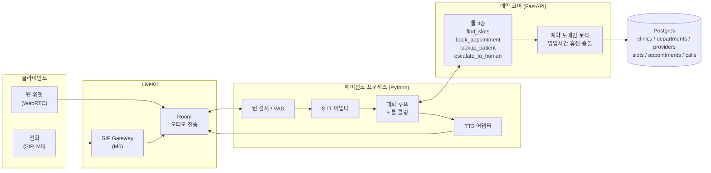

# 아키텍처

## 1. 스택 결정

의도적으로 **모든 레이어를 기존 학원용 음성 에이전트와 다르게** 잡았습니다.
같은 도메인 지식을 쓰되 코드와 인프라는 공유하지 않습니다.

| 레이어 | 이 프로젝트 | 왜 이렇게 |
|---|---|---|
| 런타임 | Python 3.12 + FastAPI | 언어까지 바꾸면 속도가 너무 깎입니다. 나머지를 전부 교체하므로 독립성은 충분합니다 |
| 음성 파이프라인 | **LiveKit Agents** | WebRTC 전송·턴 감지·끼어들기를 프레임워크가 담당. 직접 만들면 몇 주가 날아갑니다 |
| 음성 처리 | **캐스케이드 (STT → LLM → TTS)** | 아래 2절 참고 |
| 전화 인입 | WebRTC 브라우저 통화 (1순위) / SIP 트렁크 (M5) | 국내 DID는 통신사 계약이 필요합니다. 데모 단계에서 싸울 문제가 아닙니다 |
| 저장소 | **Postgres 단일** | 문서DB + RDB 이원화는 단일 정본 관리 비용만 큽니다. 예약·통화 모두 관계형이 자연스럽습니다 |
| ORM / 마이그레이션 | SQLAlchemy 2.0 (async) + Alembic | |
| 배포 | **Fly.io** | 장시간 WebSocket 연결이 핵심인데 Fly가 이 패턴에 편합니다 |
| 인증 | 없음 (M0~M4) → 단순 세션 (M6) | 데모 범위에서 인증은 본질이 아닙니다 |
| 채널 | 웹 위젯만 | 메신저 채널은 범위 밖입니다 |

**검증이 필요한 항목** — 아래는 M1 착수 전에 실제로 확인하고 결정합니다. 지금은 후보만 적어둡니다.

- 한국어 STT: 실시간 스트리밍 + 한국어 정확도 + 지연. (Deepgram / Google STT / Whisper 계열 비교)
- 한국어 TTS: 자연스러움 + first-byte 지연. (ElevenLabs / Google / 국내 벤더 비교)
- LLM: 툴 콜링 안정성 + 한국어 + 지연.

벤더는 **교체 가능하게** 감쌉니다. 어댑터 인터페이스를 두고 구현만 바꿉니다.

## 2. 왜 speech-to-speech가 아니라 캐스케이드인가

실시간 speech-to-speech 모델이 지연 면에서는 유리합니다. 그럼에도 캐스케이드를 고른 이유:

1. **중간 텍스트가 있어야 예약 로직을 테스트할 수 있습니다.** 음성이 통째로 모델 안에서 처리되면 "슬롯 충돌 시 올바르게 거절하는가"를 자동으로 검증할 방법이 없습니다.
2. **한국어 STT를 직접 통제·교체할 수 있습니다.** 의원 이름, 진료과, 의사 이름 같은 고유명사는 커스텀 어휘로 보정해야 합니다.
3. **비용을 레이어별로 통제할 수 있습니다.**
4. 벤더 하나에 묶이지 않습니다.

**대신 지연이 늘어납니다. 이걸 줄이는 것이 이 프로젝트의 핵심 기술 과제입니다.**
목표는 사용자 발화 종료 → 첫 음성 출력까지 **800ms 이하**. 수단은 STT 부분 결과로 LLM을 선제 호출, TTS 스트리밍, 짧은 선응답("네, 확인해 드릴게요") 삽입입니다.

## 3. 구성도

## 4. 대화 루프

1. 턴 감지가 발화 종료를 판정
2. STT 최종 텍스트 확정 (부분 결과는 선제 호출에 사용)
3. 대화 루프가 툴 콜링으로 LLM 호출
4. 툴이 필요하면 예약 코어 호출 → 결과를 대화에 주입 → 재호출
5. 최종 응답을 TTS로 스트리밍
6. 턴 전체를 `call_events`에 기록

**툴은 4개뿐입니다.** 툴을 늘리면 모델이 헷갈립니다. 분기는 툴 안에서 처리합니다.

| 툴 | 하는 일 |
|---|---|
| `lookup_patient` | 전화번호 + 생년월일로 초진/재진 판정 |
| `find_slots` | 진료과·의사·기간으로 예약 가능 시간 조회 |
| `book_appointment` | 예약 확정 (멱등, 충돌 시 실패 사유 반환) |
| `escalate_to_human` | 범위 밖 질문 또는 3회 실패 시 상담원 연결 |

## 5. 설계 원칙

1. **예약 확정은 코어에서만 일어납니다.** 모델은 제안만 하고, 가능/불가 판정은 전부 도메인 로직이 합니다. 모델이 없는 슬롯을 지어내도 예약은 안 잡힙니다.
2. **모든 툴은 멱등합니다.** 통화가 끊기고 다시 걸어도 중복 예약이 생기지 않습니다.
3. **벤더는 어댑터 뒤에 둡니다.** STT·TTS·LLM 전부 교체 가능해야 합니다.
4. **범위 밖은 즉시 넘깁니다.** 애매하게 답하지 않습니다.
5. **지연은 기능입니다.** 모든 턴의 구간별 지연을 측정해 기록합니다.

이 원칙들은 문서로만 있지 않습니다. 코드에 자리가 잡혀 있습니다.

| 원칙 | 어디에 |
|---|---|
| 1. 확정은 코어에서만 | `app/domain/scheduling.py` — 모델은 이 모듈을 통과해야 합니다 |
| 2. 멱등 | `book()` / `cancel()` 의 계약, `tests/test_scheduling.py` 가 지킵니다 |
| 3. 벤더는 어댑터 뒤 | `app/vendors/base.py` 프로토콜. 벤더 이름이 호출부에 없습니다 |
| 4. 범위 밖은 즉시 넘김 | `app/agent/tools.py::ESCALATE_TO_HUMAN`, `tests/test_tools.py` |
| 5. 지연은 기능 | `SpeechChunk.first_byte_ms`, `call_events.{stt,llm,tts_first_byte}_ms` |

## 6. 아직 안 정한 것

벤더 선정, 초진 진료시간 표현, 소프트 홀드 여부, 발신번호 신뢰 수준, 전사 보관 경계.
추측으로 메우지 않고 [open-questions.md](open-questions.md) 에 적어뒀습니다.
